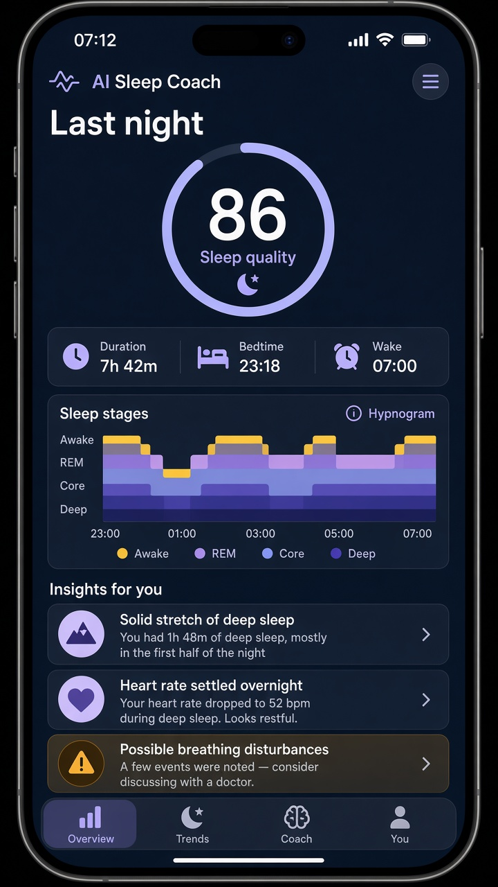
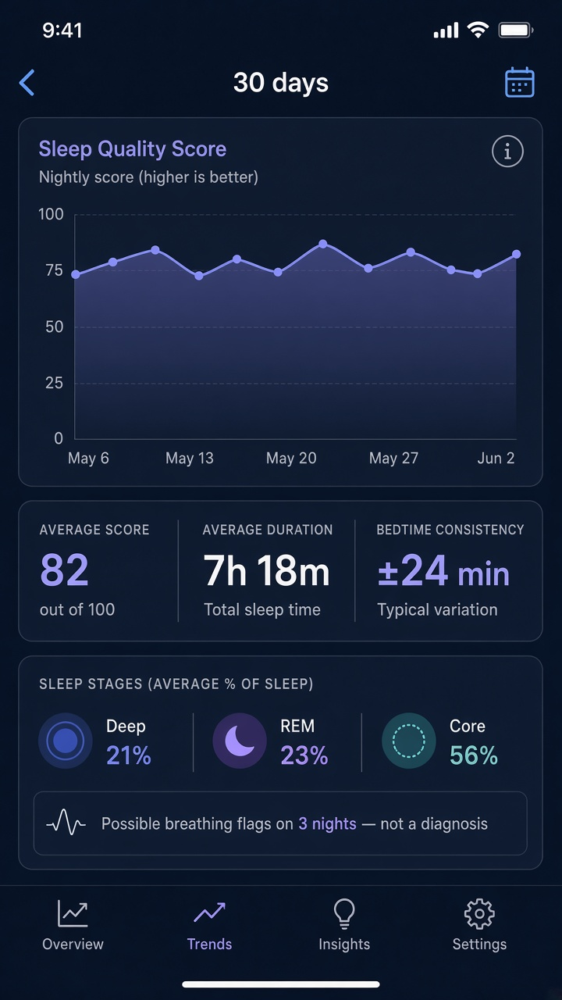
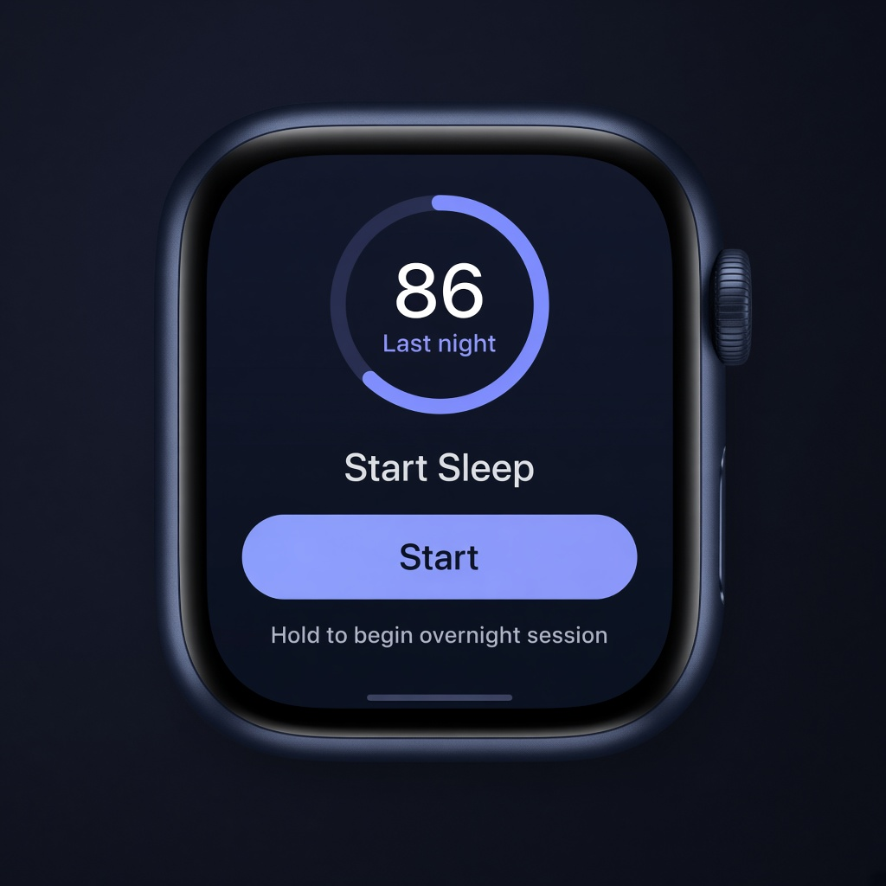
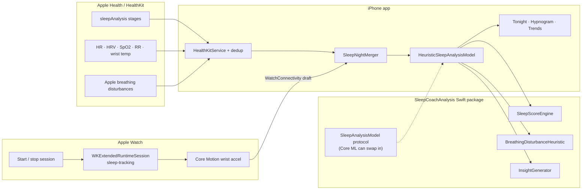

# AI Sleep Coach

Personal iPhone + Apple Watch app for **Stefan Istoc**. It scores last night’s sleep on-device, draws a hypnogram, and flags *possible* breathing disturbances from overnight signals — without sending anything to a server.

It is a wellness / portfolio project. **It is not a medical device.** It cannot diagnose sleep apnoea.

<p>
  
  
  
</p>

Mockups of the iPhone last-night screen, 30-day trends, and Watch start/stop session. The live SwiftUI app uses the same dark layout; Xcode Previews light up with built-in sample data.

## What it does

1. **Tracks sleep** with a watchOS companion session (`WKExtendedRuntimeSession` sleep-tracking). While you sleep it records wrist motion from the accelerometer. Heart rate, HRV, SpO₂, respiratory rate, wrist temperature and Apple’s own sleep stages continue to come from watchOS into Apple Health. You can skip the companion session entirely: the iPhone app still reads `HKCategoryType.sleepAnalysis` that Apple Watch already stores.
2. **Writes to Apple Health** only when Apple has not already stored a real night for that window. Apple Watch stages win; the app will not duplicate them.
3. **On-device analysis** produces a 0–100 sleep-quality score (duration, consistency, stages, restlessness, HR/HRV), plain-English insights, and heuristic flags for possible breathing disturbances (SpO₂ dips, irregular respiratory rate, heart-rate swings). It also surfaces Apple’s own Breathing Disturbances classification when HealthKit exposes it. The detector is a testable statistical model behind a stable protocol so a Core ML model can replace it later.
4. **iPhone UI:** last-night summary, hypnogram, score ring, insights, timestamped flags, 30-day trends, settings. **Watch UI:** start/stop overnight session and last-night score.
5. **Safety copy** never says “you have sleep apnoea.” Flags are “possible breathing disturbances — consider discussing with a doctor,” and Settings explains how to turn on Apple’s Sleep Apnoea notifications.

Sample-data mode is **on by default** so Simulator and Xcode Previews work without a Watch.

## Architecture



Apple Watch already records sleep stages when **Sleep** is set up. The companion session is extra (motion + a guaranteed overnight runtime). Analysis lives in `Sources/SleepCoachAnalysis`, which is plain Swift + Foundation so `swift test` runs on Linux and on a Mac.

## Repository layout

| Path | What |
| --- | --- |
| `Sources/SleepCoachAnalysis` | Score, breathing heuristic, insights, sample nights |
| `Tests/SleepCoachAnalysisTests` | Synthetic-data unit tests |
| `Apps/iPhone` | SwiftUI iPhone app + HealthKit |
| `Apps/Watch` | SwiftUI Watch app + overnight session |
| `AISleepCoach.xcodeproj` | Xcode project (iOS 18 + watchOS 11) |
| `Package.swift` | Portable Swift package |

## Run the analysis tests (Mac or Linux)

```bash
swift test
```

You do **not** need Xcode for this. CI on GitHub runs the same command.

## Install on your iPhone + Apple Watch (free Apple ID)

You need a Mac with a recent **Xcode** (16 or later / the current App Store Xcode is fine). A free Apple ID is enough for personal development signing. Paid Developer Program membership is not required.

### 1. Get the project onto the Mac

```bash
git clone https://github.com/stefandevelops/ai-sleep-coach.git
cd ai-sleep-coach
open AISleepCoach.xcodeproj
```

Or download the ZIP from GitHub and double-click `AISleepCoach.xcodeproj`.

### 2. Sign in to Xcode with your Apple ID

1. Xcode → **Settings…** (or **Preferences…**) → **Accounts**.
2. Click **+** → **Apple ID** and sign in with the same iCloud account you use on the iPhone (for Stefan: the Apple ID on the phone).
3. Select the account → **Manage Certificates…** if Xcode asks, and let it create a **Apple Development** certificate.

### 3. Pick your signing team and bundle ID

1. In the left sidebar click the blue **AISleepCoach** project.
2. Select the **AISleepCoach** target → **Signing & Capabilities**.
3. Tick **Automatically manage signing**.
4. **Team:** your personal team (it looks like your name).
5. Repeat for the **AISleepCoachWatch** target. The Watch bundle ID must stay `com.stefandevelops.AISleepCoach.watchkitapp` (or, if Apple rejects that ID as taken, change *both* IDs together, e.g. `com.yourname.AISleepCoach` and `com.yourname.AISleepCoach.watchkitapp`).
6. Confirm **HealthKit** appears under Signing & Capabilities for both targets. The entitlements files in this repo already request it.

If signing fails with “Failed to register bundle identifier”, change the bundle IDs to something unique, still keeping the Watch ID as `{iPhoneID}.watchkitapp`.

### 4. Plug in the iPhone and trust the computer

1. Unlock the iPhone, connect the USB cable, and tap **Trust** if asked.
2. On iPhone: **Settings → Privacy & Security → Developer Mode** → turn **On**, then restart if iOS asks.
3. In Xcode’s toolbar, choose your **iPhone** as the run destination (not a Simulator) if you want it on the physical Watch as well.

### 5. Run the app

Press **Play** (or Product → Run). The first time, iPhone **Settings → General → VPN & Device Management** (or **Device Management**) → tap your Apple ID → **Trust**.

The Watch app installs with the iPhone app. On the Watch, look for **Sleep Coach**. If it is missing: Watch app on iPhone → **Available Apps** → Install.

### 6. First launch

1. Read the disclaimer and continue.
2. **Settings → Connect Apple Health** and allow the listed types.
3. Leave **Use sample data** on until Health has a night, or turn it off after authorising.
4. On Apple Watch, set up **Sleep** (Watch app → Sleep) with **Track Sleep with Apple Watch**.
5. Optional: on the Watch, open Sleep Coach and tap **Start sleep** when you go to bed; **End sleep** in the morning. Last night still appears if you only wore the Watch with Apple Sleep tracking and never opened this companion.

### 7. The 7-day free-signing limit

Apps installed with a **free** Apple ID expire after **7 days**. Open the project in Xcode and press Run again to refresh. A paid Apple Developer account ($99/year) removes that limit and is required for TestFlight / App Store, not for this personal install.

### Simulator preview (no Watch needed)

Choose an **iPhone simulator** in Xcode and Run. Sample data fills last night, the hypnogram, flags and 30-day trends. Watch UI can be previewed with an **Apple Watch simulator** destination.

## Privacy

- Scoring and flags run on the iPhone.
- Health data is read from (and occasionally written to) Apple Health on device.
- Watch motion is sent to the paired iPhone with WatchConnectivity.
- There is no account, analytics SDK, or network API in this app.

## Medical disclaimer

AI Sleep Coach is **not** a medical device and is **not** intended to diagnose, treat, cure or prevent sleep apnoea or any other condition. Scores and flags are on-device heuristics and can be wrong.

A flagged event means “this overnight pattern looked unusual,” **not** “you have sleep apnoea.”

If you are worried about your sleep or breathing, talk to a GP or sleep clinician. On Apple Watch Series 9 and later, including Series 11, turn on Apple’s own **Sleep Apnoea notifications** in the Health app: Browse → Respiratory → Sleep Apnoea Notifications. That is Apple’s regulated feature; this app is not a substitute for it.

## What still needs a real iPhone + Series 11

This repository was assembled on Linux, so **Xcode itself was not run here**. Verified: `swift test` for the analysis package (synthetic nights, SpO₂ dips, merger/dedup, safety language).

Please confirm on hardware:

- HealthKit permission sheet and read of last night’s Apple sleep stages
- Dedup: Apple stages remain the only sleep timeline when Watch Sleep already recorded the night
- Companion **Start sleep** stays alive overnight (`sleep-tracking` extended runtime) and motion arrives on iPhone
- SpO₂ / respiratory rate / wrist temperature / Apple Breathing Disturbances appear when the Watch actually recorded them
- Watch last-night score updates via WatchConnectivity
- Free-team signing of both targets
